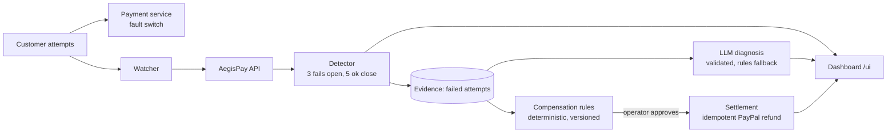

# AegisPay

**AI-assisted payment reliability and SLA compensation.** When a payment service fails, AegisPay detects it from real customer attempts, links the incident to exactly the customers who were affected, explains the cause with an LLM, and issues a deterministic, idempotent PayPal sandbox refund. Every step is auditable.

> Status: working end to end in a **PayPal sandbox** against a **simulated** payment service. See [Limitations](#limitations).

## Why

SLA credits today are usually claim-based: the customer has to notice an outage, file a request, and prove it. The provider already measured the failure. AegisPay turns that measurement into evidence and a fair, explainable credit, without anyone filing a claim.

## How it works



1. **Detect:** three consecutive failed attempts open one de-duplicated incident. It closes only after five consecutive healthy attempts, so recovery is verified by customer behaviour.
2. **Link by evidence:** a customer is affected only if they had failed attempts during the incident and a captured payment to credit.
3. **Explain:** an LLM (Groq) returns JSON with a cause, summary, and cited attempt IDs. The output is validated (schema, allowed causes, cited IDs must exist). On any failure a rule-based diagnosis is stored instead.
4. **Compensate:** versioned rules turn incident severity into an amount. The LLM never sees or decides money.
5. **Settle:** after an operator runs the settle step, each credit becomes a PayPal partial refund with an idempotency key. Re-running changes nothing.

## Run it

Prerequisites: Docker Desktop, Python 3.12+, a PayPal sandbox app (US Business account) and a Groq API key.

```bash
python -m venv .venv && .venv\Scripts\activate      # Windows
pip install -r requirements.txt
copy .env.example .env                               # then fill in your own values
docker compose up -d --build
python init_db.py                                    # creates tables
python seed_payments.py --mock 2                     # test payments (no PayPal checkout)
# optional, real sandbox payments: python seed_payments.py 3
```

Demo (separate terminals):

```bash
python watcher.py                  # simulated customers
python fault.py down               # break the payment service
python fault.py none               # recover (incident closes after 5 healthy attempts)
python explain_incident.py <id>    # AI diagnosis
python settle_incident.py <id>     # operator approval: compensation + refunds
```

Open http://localhost:8000/ui for the dashboard: **Overview** (live service status, key numbers, live attempts, demo controls to break or recover the simulated service), **Incidents**, **Incident detail** (progress, evidence, AI diagnosis, refunds, with buttons to run the AI explanation and to approve and refund) and **How it works**. The API docs are at http://localhost:8000/docs.

The dashboard buttons are an alternative to the command-line steps above. `python watcher.py` still has to run to generate customer traffic.

## Tests (no network needed)

```bash
python test_detection.py && python test_settlement.py && python test_explain.py && python test_ui_api.py
```

They use a throwaway SQLite database and a fake PayPal/LLM. They cover de-duplication, recovery, evidence linking, refund idempotency, timeout handling, and rejection of invalid LLM output.

## Design decisions

- **The LLM is an untrusted advisor.** Its output is validated and stored as text. Compensation and refund code never reads it.
- **A timeout is "unknown", not "failed".** Retries reuse the same idempotency key, and permanent errors are never retried.
- **Evidence, not time windows.** Payments are linked to an incident through recorded failed attempts.
- **Money moves only on operator approval.**
- **Simple infrastructure.** Postgres plus FastAPI, with no queue or agent framework until needed.

## Limitations

- The payment service is simulated, and detection thresholds and severity levels are demo values, not real SLA terms.
- Sandbox only. The PayPal Payouts API was rejected for my sandbox sender country, so compensation uses refunds. The sandbox merchant is US-based because India-based sandbox accounts could not complete checkout in my tests.
- Mock test payments are labelled `mock_refund` and never touch PayPal.
- No Kubernetes, automatic remediation, or post-fix verification yet. Planned next.
- The diagnosis evaluation is small (5 hand-written scenarios). It is a sanity check, not statistical proof.

## Roadmap

Kubernetes deployment with least-privilege RBAC, bounded automatic remediation (restart/rollback), independent recovery verification, and a richer evaluation set.

## License

MIT, see [LICENSE](LICENSE).
